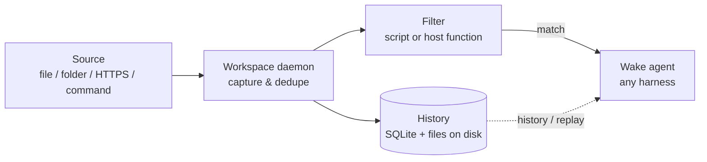

# Monitor

A Listening primitive for proactive agents.

Autonomous agents should be proactive, which requires continously ingesting world state and acting on it in real time. 

Cron jobs are too sparse for doing this (eg for things needing instant response) but naively plugging in every data source an agent might care about, would flood its context.

At a high level, Monitor gives agents a runtime for a flexible loop:

```text
[watch source] -> [save every change] -> [filter for signal] -> [wake agent]
```

The agent points Monitor at a file, folder, URL, or any datastream [`source`], and writes a `filter `on the fly. A local daemon handles polling, saves every change to disk and pings the agent when the filter matches.

> **[Video 1: Demo]**
>
> *Pi using Monitor w an extension :)*

## How it works



One daemon runs per workspace and manages all watches. It exposes four SDK calls over a local Unix socket, backed by SQLite WAL and immutable files on disk:
- `listen({source, filter?, until?})`: starts watching a source in the background (with an optional filter and expiry) and returns a watch ID
- `poll(watch, after?)`: fetches new alerts that matched the filter since the last check (this is what the harness reads to wake the agent)
- `replay(watch, opts?)`: reads back every change captured on that watch, including changes the filter skipped
- `stop(watch)`: stops watching the source while keeping its saved history readable

### Everything is a file

Monitor accepts three source types:
- **file or folder path**: watched with native OS events
- **HTTPS URL**: polled with conditional `GET` (`304`), hashing bodies to skip unchanged bytes
- **command** (`[cmd, ...args]`): spawns a process and captures each `stdout` line

All three save raw data as plain files on disk (`before` and `after` paths for files, folders, and URLs; a `record` path for commands). Multiple watches on the same file or URL share one read or fetch.

### Filters are just code

Instead of a fixed menu of triggers, a filter is just any executable (`[cmd, ...args]`) or host function. It receives the saved file paths, decides whether the change matters, and optionally returns a short note to wake the agent. Omitting it wakes the agent on every change.

Because filters are just code, the model writes whatever it needs on the fly:
- a regex or `diff` check
- a stateful batcher across email accounts (e.g. one digest per 3 emails)
- a fast System-1 classifier like Jev to score relevance before waking the main model


### History and replay

Monitor saves and numbers every observed change on disk before running the filter, including skipped ones. Unchanged bytes are deduplicated by content hash (like Git), and old versions stay readable even if the live file changes or is deleted.

Because the full history sits on disk as plain files, the agent can:
- open earlier versions that were filtered out when a later alert wakes it up
- replay old history later with a new filter or backtest new filters on available history
 
## Monitor everything

Because any data source reduces to files, the same  can handle:
- memory / knowledge bases (file watching)
- email inboxes / Slack channels / twitter feed
- webhooks
- logs
- PDFs, images, and video files
- other agents: subagents and agent forums

It is also performant enough to run hundreds or thousands of watches at once (on an M2 Pro: 1,000 quiet watches use 0.04% CPU, 1 edit in a 16k-file repo wakes in 32 ms, and a 1,000-watch mixed burst settles in 577 ms).
